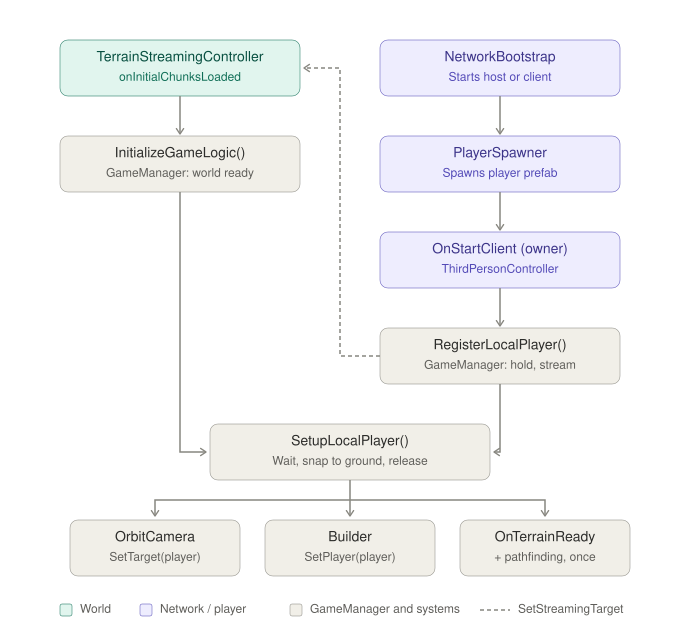
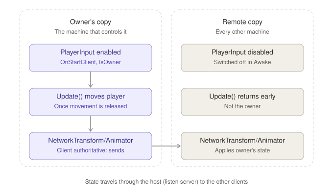

# Multiplayer Plan (FishNet)

Plan for making this project network-enabled with FishNet 4.x. Reference guide: `fishnet.md` (FishNet reference notes, section numbers below point to it).

## Decisions

| Decision | Choice |
|---|---|
| Topology | **Host (listen server).** One player's process is both server and client. The code stays compatible with a later dedicated server. |
| Build-piece sync | **One networked object per `BuildingArea`**, holding a synced dictionary of piece records. Pieces themselves are plain local GameObjects on clients. |
| Player movement | **Client-authoritative** `NetworkTransform` and `NetworkAnimator`. Client-side prediction can be added later if cheating becomes a concern. |

## Guiding principles

- **Terrain is never sent over the network.** The server shares the seed, and every machine generates identical chunks and scatter prefabs locally.
- **The server is the authority for the world:** building, terrain edits, structural integrity, pathfinding, NPCs, inventory and save/load. Clients send requests and render the results.
- **On the host, server and client share one process,** so the host's `TerrainStreamingController` and physics serve both roles. Server-only code must check `IsServerInitialized` or `InstanceFinder.IsServerStarted`, not "am I the host".

## Constraints found in the code

1. **Scatter placement is not deterministic across machines.** [AsyncTerrainPrefabPlacer.cs:310](Assets/Goodgulf/TerrainUtils/AsyncTerrainPrefabPlacer.cs) seeds with `rule.prefab.GetInstanceID()`, which differs between the editor, builds and sessions. Colliders and pathfinding would disagree between machines. This must be fixed first (Phase 0).
2. **`TerrainStreamingController` follows a single `player` Transform.** The server needs chunks loaded around every player.
3. **Building has a clean request point.** `BuilderInput` computes the preview, raycast and snap, then calls `Builder.InstantiateBuildingPrefab(templateId, pos, rot, snapIndex)`, which becomes the client-to-server request.
4. **The central services are singletons**: `Builder`, `RecalculationWorker`, `TerrainGraphIntegration` and `GameManager`. They stay singletons, since there is one NetworkManager, but their authoritative logic is gated to the server.
5. **`GameManager.InitializeGameLogic()` is triggered by the streaming controller's initial-load event and enables a scene-placed player.** The player will now be spawned by the network, so this flow changes.
6. **FishNet exists in the main checkout's `Assets/FishNet` but is not committed**, so it isn't in git or this worktree.

---

## Phase 0: Groundwork

- [x] Put FishNet under version control: commit `Assets/FishNet`, or install through the Git URL (`https://github.com/FirstGearGames/FishNet.git?path=Assets/FishNet`).
- [x] Add Multiplayer Play Mode (`com.unity.multiplayer.playmode`) for testing a host and a client in the editor.
- [x] Per-player chunk caches: `PlayModeInstance.GetInstanceDataPath` gives MPPM virtual players their own `TerrainPrefabCache_<id>` folder.
- [x] `NetworkBootstrap` (on the NetworkManager): starts host, server or client from `-host`/`-server`/`-client` (plus `-address`, `-port`), then MPPM tags `Host`/`Server`/`Client`, then the Inspector default. Set the NetworkHudCanvas Auto Start Type to Disabled.
- [x] Fix placement determinism in `AsyncTerrainPrefabPlacer` (and the older `TerrainPrefabPlacer`):
  - Replaced `GetInstanceID()` in the rule seed with `StableHash.Fnv1a(prefab.name)`.
  - `prefabId` and `PrefabPlacementConfig.GetConfigHash()` also use `StableHash.Fnv1a` instead of `string.GetHashCode()`.
  - `ChunkPrefabCache.CurrentCacheVersion` is now 2, and `IsValid` rejects older caches.
  - Note: rules are identified by prefab *name*, so two different prefabs with the same name in one config would share a seed.
- [x] Verify determinism: start two editors with the same seed, dump the placed-prefab records for several chunks, and diff them.
  - Dump: F9 or the "Dump Placement Records" context menu on `AsyncTerrainPrefabPlacer`.
  - Fixed on the way: cache loads now replay terrain modifications, and each placement call pins its own terrain.
  - Passed: (A) both caches cold, (B) one warm and one cold, (C) a fresh editor session. (D) a standalone build was not run.

## Phase 1: Connecting and spawning the player

Goal: a host and one client walk around the same terrain.

How the pieces fit together:

- **Startup:** `WorldState` starts streaming with the shared seed (Phase 2). The world path and the player path meet in `GameManager.SetupLocalPlayer`, which places the player and hands it to the camera, `Builder` and pathfinding.

  

- **Owner vs remote copy:** only the owner's copy reads input and moves; every other copy follows its `NetworkTransform`/`NetworkAnimator`.

  

Code (done on `claude/phase1-networked-player`; needs the editor setup below before it can be tested):

- [x] Convert `ThirdPersonController` to a `NetworkBehaviour`:
  - `Update` returns unless `IsOwner` and movement has been released.
  - `PlayerInput` is disabled in `Awake` and enabled in `OnStartClient` for the owner only (§27). Input callbacks only fire while it is enabled, so they need no separate guard.
  - The `CharacterController` on non-owners is left to the `NetworkTransform` (Component Configuration).
  - `orbitCamera` and `builderInput` can't be scene references on a prefab; the owner resolves them from `GameManager.PlayerCamera` and `BuilderInput.Instance`.
- [x] Camera: one scene camera with `OrbitCamera`. `GameManager` calls `OrbitCamera.SetTarget(localPlayer)` and switches from the scene camera once the player is placed.
- [x] Rework `GameManager`. Instead of `InitializeWorld()`/`OnLocalPlayerSpawned()`:
  - `InitializeGameLogic()` (still wired to `onInitialChunksLoaded`) only marks the world ready and calls `Builder.CacheTerrains`.
  - `RegisterLocalPlayer(player)` is called by the owner's `OnStartClient`; `UnregisterLocalPlayer` by `OnStopClient`.
  - When both are ready, `SetupLocalPlayer` places the player, switches the camera, calls `Builder.SetPlayer`, then `OnTerrainReady` and the `TerrainGraphIntegration` initialization (once). Moving that to the server path is still Phase 5.
- [x] Interim streaming target (Phase 2 generalizes it): `TerrainStreamingController.SetStreamingTarget(Transform)` and `IsChunkLoadedAt(Vector3)`. Its `player` field now holds the spawn point until the local player registers.
- [x] Spawn safety:
  - The local player is held (no gravity or movement) until the chunk under it has loaded locally.
  - It is then snapped to the ground below (`GameManager._groundMask`) and released.
  - Server-side spawn-point selection moved to Phase 2. For now, PlayerSpawner's Spawns must sit inside the initial load radius around the spawn point.
- [x] `TerrainPositionObjects` skips missing entries (the player is no longer a scene object).

Editor setup:

- [x] Add a NetworkManager scene object (start from `FishNet/Demos/Prefabs/NetworkManager.prefab`):
  - Add `NetworkBootstrap` and set the HUD's Auto Start Type to Disabled.
  - ObserverManager with a **SceneCondition**.
  - PlayerSpawner with **Add To Default Scene** checked, and a spawn point in **Spawns**.
  - The HUD, for starting host or client.
  - The NetworkManager must not carry a NetworkObject (§4).
- [x] Spawn point: an empty GameObject where players should appear. Assign it to `TerrainStreamingController.player` and to PlayerSpawner's Spawns.
- [x] Player prefab:
  - Move the scene player into a prefab. Disable its `PlayerInput` component on the prefab.
  - Add `NetworkObject`, a client-authoritative `NetworkTransform` (Component Configuration = CharacterController) and a client-authoritative `NetworkAnimator`.
  - Assign it to PlayerSpawner and delete the scene player.
- [x] `GameManager`: assign the streaming controller and set **Ground Mask** to the terrain layer (the same mask `TerrainPositionObjects` uses).
- [x] MPPM scenario: Player Tags `Host` and `Client`; Main Editor = `Host`, Virtual Editor = `Client`.

Done when:

- [x] Host and client each see both players move smoothly, and each camera follows its own player.
- [x] Neither player falls through the terrain at spawn.
- [x] The F9 dumps from host and client still match.

Expected until later phases: building is local to each player (Phase 3), and the host only streams terrain around its own player, so a distant client floats over unloaded ground on the host's screen (Phase 2).

## Phase 2: World sync

- [x] `WorldState` (`Networking/WorldState.cs`): a global NetworkObject with `SyncVar<int> _seed`.
  - The server sets the seed in `OnStartServer` (`-seed <n>` on the command line, else the Inspector default) and starts its own streaming.
  - Clients call `TerrainStreamingController.BeginStreaming(seed)` in `OnStartClient`, which applies it to `AsyncTerrainPrefabPlacer.SetBaseSeed` and `StreamingTerrainGeneratorJobs.seed`. On the host the second call is ignored.
  - Streaming no longer auto-starts in `Start()` while **Wait For World Seed** is on (the default). Turn it off to stream offline with the controller's own seed.
  - Note: terrain heights don't use the seed today (`TerrainHeightJob` is a pure function of world position); only prefab placement does.
- [x] Multi-target streaming. `TerrainStreamingController` follows a list of targets (`RegisterStreamingTarget` / `UnregisterStreamingTarget`, reference counted):
  - The load set is the union of the radii around all targets; queued loads no target needs are dropped.
  - A chunk unloads only when it is outside the unload radius of every target.
  - The server registers every player in `ThirdPersonController.OnStartServer` (and unregisters in `OnStopServer`) rather than subscribing to `OnSpawned`.
  - A pure client registers only its own player (`GameManager.RegisterLocalPlayer`), makes it the primary target and releases the spawn point.
  - The host registers everyone (its own player twice, hence the reference count), and also renders chunks around remote players. That cost is accepted for host mode.
  - `SetStreamingTarget` is gone. `Player()` now returns the primary target (the local player), so pathfinding still centres on it.
- [x] Editor setup for the two items above:
  - Create a `WorldState` prefab: `NetworkObject` with **Is Global** on and **Initialize Order** -128, plus the `WorldState` component.
  - Add a `ServerSpawner` to the NetworkManager and list the prefab in it.
  - Check `TerrainStreamingController` → **Wait For World Seed** is on.
- [x] Test: host and client both load the world (it now waits for the seed), F9 dumps still match, and on the host a client that walks several chunks away has terrain loaded under it.
- [x] Spawn points (moved from Phase 1): `WorldPlayerSpawner` (`Networking/WorldPlayerSpawner.cs`) replaces FishNet's PlayerSpawner, which knows nothing about terrain.
  - On `OnClientLoadedStartScenes` the server waits for streaming to start, then tries the spawn points round robin and takes the first whose chunk it has loaded.
  - If none is loaded, the chosen spawn point becomes a temporary streaming target until its chunk loads; it is released once the spawned player has registered itself.
  - The spawn position is snapped to the ground the server sees (`GameManager.TryFindGround`, shared with the client-side snap), plus a small height offset.
  - The client still holds its player until its own copy of the chunk has loaded (`GameManager.SetupLocalPlayer`).
- [x] Editor setup for spawn points:
  - On the NetworkManager, remove FishNet's **PlayerSpawner** and add **WorldPlayerSpawner** (both at once would spawn every player twice).
  - Assign the player prefab, keep **Add To Default Scene** on, and move the spawn point(s) into **Spawns**.
- [x] Test: host and client spawn on the ground as before. With a dedicated server or after every player has left the spawn area, a joining client still spawns on loaded ground (the log shows "Loading terrain at spawn point").
- [x] Terrain edits:
  - `Builder.DepressTerrainAtPosition` and `RaiseTerrainAtPosition` call `WorldState.RequestTerrainEdit` in a network session (a ServerRpc, `RequireOwnership = false`). Offline they still edit the active terrain directly.
  - The server checks the request (caller has a player, `_maxEditReach`, `_minEditInterval`, `_maxEditRadius`/`_maxEditDepth`, chunk loaded on the server) and appends a `TerrainEdit {chunk, position, radius, depth}` (`TerrainUtils/TerrainEdit.cs`) to `SyncList<TerrainEdit> _terrainEdits` on `WorldState`.
  - Every machine applies new edits to loaded chunks from the list's `OnChange` (the host only once, from the server callback), and replays a chunk's edits from `TerrainStreamingController.ChunkTerrainReady`, raised after generation and prefab placement but before the chunk counts as loaded.
  - A per-chunk count of applied edits makes each edit apply exactly once per load of a chunk, whether it arrives live or is replayed.
  - Every machine that applies an edit live calls `InvalidateHeightmapCache` and `RequestDirtyRegionRebuild`, since `TerrainGraphIntegration` still runs everywhere (Phase 5 moves it to the server).
  - Edits only live for the session; saving them is Phase 6.
- [x] Test: no editor setup needed (the limits are new fields on the `WorldState` component).
  - Raise and depress terrain on the host and on the client; both see every edit.
  - Edit a chunk, walk until it unloads (beyond the unload radius) and come back: the edit is still there. A client that joins after edits were made sees them too.
  - After edits, the F9 dumps from host and client still match (the heightmap hashes include the edits).
  - An edit further away than **Max Edit Reach** is rejected (logged on the server).

## Phase 3: Building (one networked object per BuildingArea)

- [x] `NetworkBuildingArea` (`Building/NetworkBuildingArea.cs`): a `NetworkBehaviour` for one `BuildingArea`.
  - `SyncVar<string> _areaId`; the position is the NetworkObject's own transform, so no extra SyncVar.
  - `SyncDictionary<int, PieceRecord> _pieces`, where `PieceRecord` is a struct `{ int Id; int TemplateId; Vector3 Position; Quaternion Rotation; int SnapIndex; }`.
  - [ ] Optional, editor: per-area visibility with a **GridCondition** (or DistanceCondition) on the prefab's `NetworkObserver` in *Add Missing* mode, plus a HashGrid on the NetworkManager. Without it every client receives every area, which is fine at this scale.
- [x] Server:
  - `Builder.GetOrCreateBuildingArea` instantiates and spawns the `NetworkBuildingArea` (server only; offline it still creates the outline directly).
  - The outline visual (`BuildingAreaOutline`) is created locally on each client in `OnStartClient` (`Builder.CreateAreaOutline`).
  - Areas are now registered on `Builder` by global grid coordinate instead of on the chunk's `BuildableTerrain`, which is destroyed when the chunk unloads. `Builder.TryGetTerrainAt` re-caches terrains when a streamed-in chunk is missing.
- [x] Build request flow:
  1. The client-side `BuilderInput` keeps the transparent preview, raycast, snapping, rotation and magnetic snap, all local.
  2. On confirm, `Builder.RequestBuild` calls `PlayerBuilderInventoryBridge.ServerRequestBuild(templateId, pos, rot, snapIndex)`, a ServerRpc on the player prefab, so the caller is the owning player.
  3. The server validates: template index, snap index, inventory, non-buildable areas (`IsPositionInNonBuildableArea`, position based because the server has no preview), reach (`Builder._maxBuildReach`), rate (`_minBuildInterval`), terrain loaded, and duplicates (`IsDuplicatePiece`: same template at the same position and rotation; pieces are meant to touch, so a full overlap check would reject valid snaps).
  4. The server runs the existing `InstantiateBuildingPrefab` (grounding, neighbours, `ConstructedItem` with an ID from `GetNewGlobalID`) and adds a `PieceRecord` to the area's `Pieces`. It no longer needs a local player.
  5. `InstantiateBuildingPrefab` calls `TerrainGraphIntegration.InvalidateObstacleCache(pos, Builder.ObstacleInvalidationRadius)`.
- [x] Clients: `Pieces.OnChange` Add/Set instantiates a copy of the build prefab under the area (`Builder.InstantiatePieceCopy`, same snap offsets as the server) and Remove destroys it; `OnStartClient` builds all existing records for late joiners and areas coming into view (idempotent with the initial sync callbacks). The host skips this, since the server's pieces are already there. Copies have no `ConstructedItem`; they invalidate the local pathfinding obstacle cache too, because pathfinding still runs everywhere until Phase 5.
- [x] Destruction: `DestructConstructedItemsAtPos` collects the piece IDs under the preview locally, then calls `ServerRequestDestruct(ids)`; the server keeps the existing pieces within reach and removes them. Every removal (destroy or collapse) goes through `Builder.OnConstructedItemRemoved`, which removes the record and invalidates the obstacle cache.
- [x] Inventory: `PlayerBuilderInventoryBridge` is a `NetworkBehaviour` with a `SyncDictionary<int,int>` (`WritePermission.ServerOnly`, `ReadPermission.OwnerOnly`). The server fills it in `OnStartServer`; consumption only happens on the server during build validation.
- [x] Save, load and the debug build grid only run on the server in a network session (persistence proper is Phase 6).
- [ ] Editor setup:
  - Create a `NetworkBuildingArea` prefab: an empty GameObject with a `NetworkObject` (Is Global off) and the `NetworkBuildingArea` component. Assign it to **Builder → Network Building Area Prefab**.
  - The player prefab already has `PlayerBuilderInventoryBridge`; it is now a NetworkBehaviour, so just re-save the prefab if Unity asks.
- [ ] Test:
  - Host and client both build; each sees the other's pieces, including snapped pieces.
  - Destroy a piece from either side; it disappears on both.
  - A client that joins after building sees all pieces and area outlines.
  - Inventory runs out on the server (the build is rejected with a log line), and an out-of-reach build is rejected.
  - Building on a chunk that streamed in after startup works, and walking away and back doesn't duplicate an area.

Known gaps until Phase 4: structural integrity (`RecalculationWorker`) still only runs around the host's own player, and collapses remove pieces on clients without the falling effect.

## Phase 4: Structural integrity

- [ ] Run `RecalculationWorker`, `Builder.UpdateWorkerAreas` and neighbour detection only on the server. Disable them on pure clients.
- [ ] Removing weak pieces (`BuildingArea.RemoveWeakConstructedItems`) on the server:
  - Remove the records from `Pieces`.
  - Call `ObserversCollapse(int[] pieceIds)` on the area.
  - Clients run the existing "unfreeze rigidbody, destroy after 10 s" effect on their local copies.
  - The dictionary removal must not destroy a piece that is collapsing. Mark collapsing IDs first (the RPC arrives before the SyncType change, §13).
- [ ] Optional debug: sync `Distance` into `PieceRecord` for the `ShowDistances` overlay.

## Phase 5: Pathfinding and NPCs

- [ ] Initialize `TerrainGraphIntegration` only on the server (`OnStartServer` path of `GameManager`). Disable the component on pure clients.
- [ ] Obstacle and height invalidation on the server after every build, destroy, collapse and terrain edit. Phases 2–4 cover these.
- [ ] `PathfindingAgent`:
  - Becomes a spawnable NetworkObject prefab with a server-authoritative `NetworkTransform`. Path requests and movement run only on the server.
  - `PlayerTransform` becomes "nearest player" on the server, for LOS approach and flee.
  - Patrol points and leader references are set at spawn, or become NetworkObject references.
- [ ] Add a GridCondition or DistanceCondition to agents so clients only receive nearby NPCs.

## Phase 6: Persistence and hardening

- [ ] Only the server runs `SaveAllBuildingAreas` and `LoadBuildingArea`. Loading spawns the `NetworkBuildingArea`s and fills `Pieces`, and late joiners receive them automatically. Save the terrain edit list alongside.
- [ ] Handle disconnects:
  - Unregister the player's streaming target.
  - Decide whether building and inventory persist per player.
- [ ] Latency testing: TransportManager latency simulator at 100–150 ms and 1–3% loss. Check build confirmation latency and collapse timing.
- [ ] Logging: a FishNet `LevelLoggingConfiguration`. Keep project logging on `IDebuggable`/`GameLogger`.
- [ ] Later / optional:
  - Authenticator (player names)
  - dedicated-server build profile (skip grass/detail/visual scatter on headless)
  - client-side prediction for movement

## Testing checklist per phase

- Host alone, host plus one client (Multiplayer Play Mode), and a client that joins late after building and terrain edits have happened.
- Both clients see the same trees, rocks and terrain height at the same coordinates.
- Pieces built by either player appear for both. Collapse plays on both. NPCs path around new walls.
- No errors from the `[Server]`/`[Client]` guards in the console on either side.
