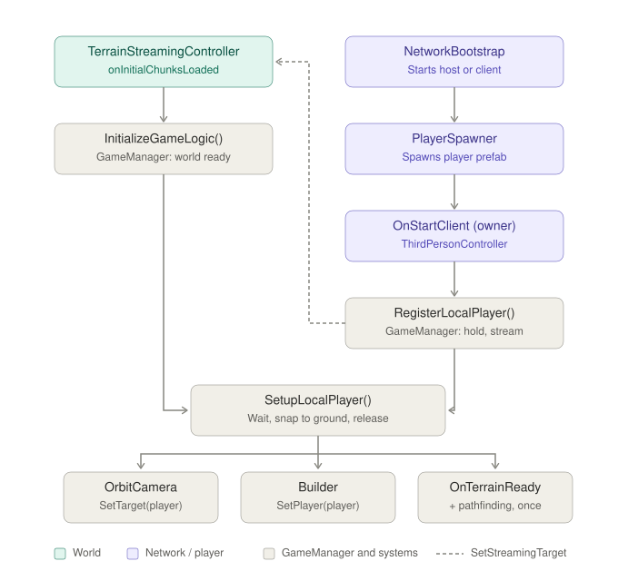
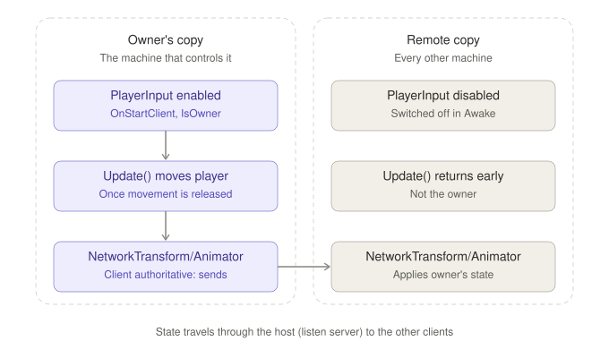
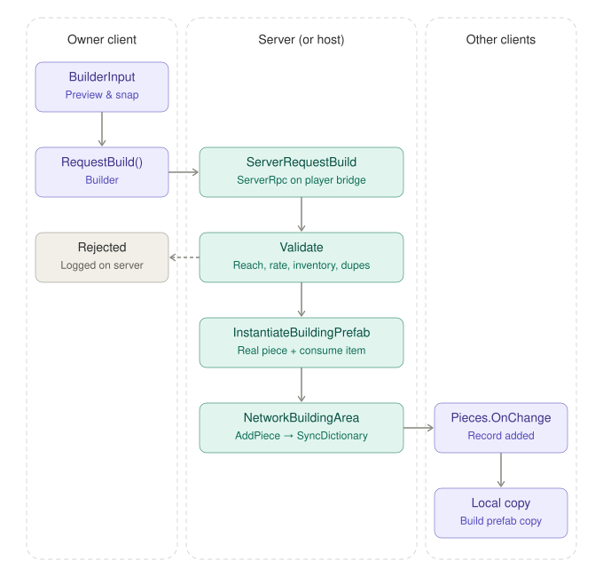
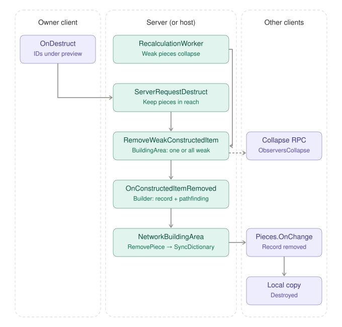
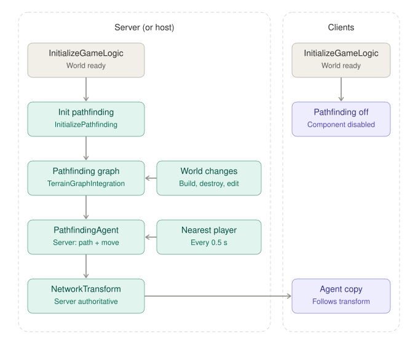
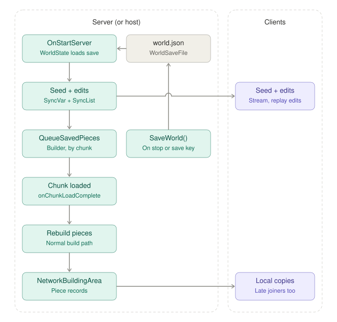

# Survival Game, Part 6: multiplayer with FishNet

A Unity 6 survival game built in a YouTube tutorial series: streamed procedural terrain, a player building system with structural integrity, and a custom Burst-accelerated A* pathfinder. Episode 6 makes the whole game **multiplayer** with [FishNet](https://fish-networking.gitbook.io/docs).

- Episode 5 (building changes the pathfinding grid): https://youtu.be/49oQ7giICds
- Episode 6: networking the game with FishNet (this repository)


## What the game does

| System | What it does | Code |
|---|---|---|
| Terrain streaming | Loads and unloads 1 km terrain chunks around the players. Heights come from Burst jobs; trees and rocks are placed procedurally and cached per chunk. | `Assets/Goodgulf/TerrainUtils/` |
| Building | Snap-together building pieces grouped in 100 m building areas, with structural integrity (Dijkstra on a background thread) that makes unsupported pieces collapse. | `Assets/Goodgulf/Building/` |
| Pathfinding | A custom double-buffered A* grid built from the terrain plus a physics obstacle pass, and NPC agents that patrol, follow and approach or flee from players. | `Assets/Goodgulf/Pathfinding/` |
| Player | Third-person controller and orbit camera on the new Input System. | `Assets/Goodgulf/Controller/` |
| Networking | FishNet bootstrap, the shared world state, terrain-aware player spawning and the world save. | `Assets/Goodgulf/Networking/` |

## How multiplayer was added

Three decisions shaped the work (see [PLAN.md](PLAN.md)):

1. **Host mode:** one player is both server and client. The code also works with a dedicated server.
2. **The server owns the world:** building, terrain edits, structural integrity, pathfinding, NPCs, inventory and saving all run on the server. Clients send requests, and the server validates them.
3. **Terrain is never sent over the network:** the server shares a seed, and every machine generates an identical world. Generation therefore has to be deterministic, and there's a tool to prove that it is.

The work was done in seven phases. Each one is described in detail, with its checklist, in [PLAN.md](PLAN.md).

| Phase | What was implemented | Key code | Diagram |
|---|---|---|---|
| **0 · Groundwork** | Deterministic prefab placement (`StableHash.Fnv1a` instead of `GetInstanceID()`). An F9 dump of every chunk's placements and heightmap hash, to diff between machines. Fixes for terrain flattening that wasn't replayed from the cache, and for a race between concurrently loading chunks. Separate caches per Multiplayer Play Mode player, and automatic host/client startup. | `StableHash`, `AsyncTerrainPrefabPlacer`, `PlayModeInstance`, `NetworkBootstrap` | [Part 1 overview](docs/video/part1-sketchbook.svg) |
| **1 · Networked player** | `ThirdPersonController` as a `NetworkBehaviour`: the owner reads input and moves, and remote copies follow a `NetworkTransform`. A two-sided startup that waits for the world and the local player, holds the player until its chunk has loaded, then snaps it to the ground. | `ThirdPersonController`, `GameManager` | [Startup](docs/phase1-player-startup.svg) · [Owner vs remote](docs/phase1-owner-vs-remote.svg) |
| **2 · World sync** | `WorldState` sends the seed to everyone. Streaming follows a reference-counted list of targets (every player on the server). `WorldPlayerSpawner` only spawns on loaded ground. Terrain edits are validated server requests, kept in a synced list, applied live and replayed when a chunk loads. | `WorldState`, `TerrainStreamingController`, `WorldPlayerSpawner`, `TerrainEdit` | [Startup](docs/phase1-player-startup.svg) |
| **3 · Networked building** | One `NetworkBuildingArea` per building area, syncing small `PieceRecord`s instead of a network object per piece. Build and destroy go through ServerRpcs with server-side validation. Clients build local copies, late joiners included. The inventory is server-written and readable only by its owner. | `NetworkBuildingArea`, `PlayerBuilderInventoryBridge`, `Builder` | [Build request](docs/phase3-build-request.svg) · [Piece removal](docs/phase3-piece-removal.svg) |
| **4 · Structural integrity** | Recalculation only on the server, around every connected player. `ObserversCollapse` reaches clients before the record removal, so they play the falling effect. Also fixed: a world-origin bug that kept blocks from collapsing away from spawn. | `RecalculationWorker`, `BuildingArea`, `NetworkBuildingArea` | [Piece removal](docs/phase3-piece-removal.svg) |
| **5 · Pathfinding and NPCs** | The pathfinding graph is built only on the server, as soon as the world is ready, and disabled on clients. `PathfindingAgent` is server authoritative and targets the nearest player. | `GameManager.InitializePathfinding`, `TerrainGraphIntegration`, `PathfindingAgent` | [Pathfinding](docs/phase5-pathfinding.svg) |
| **6 · Persistence** | One world save holding the seed, the pieces in build order and the terrain edits. It's loaded when the server starts, and saved when it stops or with the save key. Saved pieces are rebuilt as their chunk loads. | `WorldSave`, `WorldState`, `Builder.QueueSavedPieces` | [Save and load](docs/phase6-persistence.svg) |

## Diagrams

**Startup: the world and the local player come together in `GameManager`**



**Owner vs remote copy of a player**



**Placing a piece**



**Removing pieces (destroy and collapse)**



**Server-authoritative pathfinding and NPCs**



**World save and load**



### Sketchbook overviews

Hand-drawn summaries, one per part of the series. They use the Caveat font from Google Fonts, so open them in a browser with an internet connection; offline they fall back to a plain cursive font.

| File | Covers |
|---|---|
| [part1-sketchbook.svg](docs/video/part1-sketchbook.svg) | Phases 0–2: same world, networked player, shared world |
| [part2-sketchbook.svg](docs/video/part2-sketchbook.svg) | Phases 3–4: building together and collapses |
| [part3-sketchbook.svg](docs/video/part3-sketchbook.svg) | Phases 5–6: NPCs on the server and the world save |
| [pathfinding-limitation-sketchbook.svg](docs/video/pathfinding-limitation-sketchbook.svg) | The known pathfinding-graph limitation and fix ideas |

## Key documents

| File | What's in it |
|---|---|
| [PLAN.md](PLAN.md) | The multiplayer plan: decisions, guiding principles, and every phase with its checklist, editor setup and tests |
| [docs/NetworkBuilding.md](docs/NetworkBuilding.md) | Every block in the two building diagrams explained, mapped to the code |
| [fishnet.md](fishnet.md) | FishNet 4.x reference notes; the § numbers in `PLAN.md` point here |
| [CLAUDE.md](CLAUDE.md) | Architecture overview, startup order, cross-system contracts and code conventions |

## Getting started

1. **Unity 6000.0.68f1** (Unity 6) with URP. The project uses the new Input System, Cinemachine, Burst, Jobs, Collections and Mathematics.
2. **Add FishNet 4.7.3 manually with the Unity Package Manager.** It isn't included in this repository, and the project won't compile without it.
   - Open **Window → Package Manager**.
   - Choose **+ → Add package from git URL…**.
   - Enter `https://github.com/FirstGearGames/FishNet.git?path=Assets/FishNet`.
3. Open `Assets/main scene.unity`.
4. **Host and client in the editor:** open the Play Mode Scenarios window (Window → Multiplayer) and select the `NetworkingScenario`. The Main Editor is tagged `Host` and the virtual player `Client`. `NetworkBootstrap` reads those tags and starts each one.

**Command-line flags (builds):** `-host`, `-server` or `-client`, plus `-address <ip>`, `-port <port>` and `-seed <n>`.

**Handy in Play Mode:**
- **F9** writes every loaded chunk's placement records and heightmap hash to `persistentDataPath/PlacementDumps[_<player id>]/`. Diff two players' dumps: they must be identical.
- The **save key** writes the world to `persistentDataPath/Saves[_<player id>]/world.json`. The server loads it automatically on its next start.

## One rule to remember

After placing or destroying anything that should block NPCs, the pathfinding obstacle cache has to be told. In a network session this happens on the server, and `Builder` already does it for every build, destroy and collapse:

```csharp
TerrainGraphIntegration.Instance.InvalidateObstacleCache(position, radius); // or (worldMin, worldMax)
```

In a network session, terrain height edits must go through `WorldState.RequestTerrainEdit`, never straight to `TerrainData`. Otherwise they're lost when the chunk reloads, and machines stop agreeing on the terrain.

## Known limitations and next steps

- **The pathfinding graph covers the area around one player only:** the host's player, or the first player on a dedicated server. NPCs near a distant player have no graph. While a loaded chunk sits outside the graph, every new chunk load may also trigger a full graph rebuild. That second point was found by reading the code and hasn't been observed in-game yet. See [the limitation diagram](docs/video/pathfinding-limitation-sketchbook.svg).
- **Inventory is per connection** and resets on reconnect. Saving it per player needs an Authenticator first.
- **Optional, not done:** GridConditions so clients only receive nearby building areas and NPCs, an Authenticator, a dedicated-server build profile, and client-side prediction for movement.

## License

[MIT](LICENSE)
