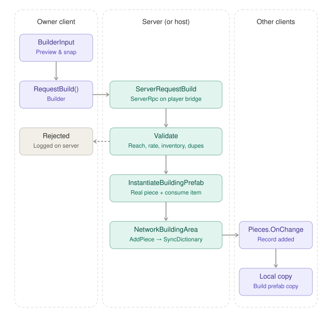
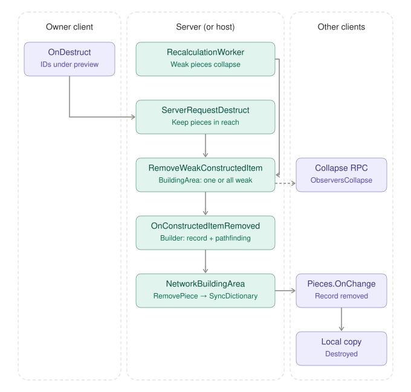

# Networked building

How building works in a network session (Phase 3 of `PLAN.md`). The server owns building: it creates the real pieces, runs structural integrity and spends inventory. Clients only send requests and show copies of what the server built.

Two diagrams cover the whole workflow: one for placing a piece, one for removing pieces. Each has three lanes:

- **Owner client:** the player who is building. On the host this is the host's own player, and its requests run in the same process as the server.
- **Server (or host):** where the real pieces, `ConstructedItem` data and inventory live.
- **Other clients:** everyone else, who only see copies of the pieces.

Teal blocks run on the server, purple blocks on a client, and the gray block is a dead end (a rejected request).

## Placing a piece

### Owner client

**BuilderInput (preview & snap)**
`Building/BuilderInput.cs`. Everything about choosing *where* to build stays on the client, so it feels instant: the transparent preview, the cursor raycast, grid snapping, rotation, snap points and magnetic snapping. When the player clicks (`OnClick`), it first does two quick local checks so obvious mistakes aren't sent at all: is there inventory left for this template (`PlayerBuilderInventoryBridge.InventoryLeft`, reading the synced inventory), and is the preview inside a non-buildable area. Then it calls `Builder.RequestBuild` with the template, position, rotation and snap index.

**RequestBuild() (Builder)**
`Builder.RequestBuild` in `Building/Builder.cs`. The switch between networked and offline building. In a network session it forwards the request to the local player's `PlayerBuilderInventoryBridge.RequestBuild`, which sends the ServerRpc. Offline it would build directly, but offline building no longer works because only the server can change the inventory (and the player is always network-spawned now).

**Rejected (logged on server)**
Not a method: the end of the line for a request that fails validation. The server logs a warning naming the client and the reason (`PlayerBuilderInventoryBridge.Reject`). Nothing is built and nothing is sent back, so on the owner client the click simply has no effect.

### Server

**ServerRequestBuild (ServerRpc on the player bridge)**
`PlayerBuilderInventoryBridge.ServerRequestBuild` in `Building/PlayerBuilderInventoryBridge.cs`. A FishNet `[ServerRpc]` on the player prefab, so only the player's owner can call it and the server knows exactly which player is asking: the object the RPC runs on. This matters for the checks that follow, which use this player's position and this player's inventory.

**Validate (reach, rate, inventory, dupes)**
Still inside `ServerRequestBuild`. Client input is untrusted, so the server checks everything again, in this order:

1. The template index exists (`Builder.GetBuildItemTemplate`).
2. Rate: at least `Builder._minBuildInterval` (0.1 s) since this player's last accepted request.
3. Reach: the position is within `Builder._maxBuildReach` (30 m) of the player.
4. The snap index is within the template's snap points.
5. Inventory: the player has at least one of this item (the server's copy of the inventory).
6. Non-buildable areas: `Builder.IsPositionInNonBuildableArea`, a distance check against each `NonBuildableArea`. It is position based because the server has no placement preview to overlap with.
7. Duplicates: `Builder.IsDuplicatePiece` rejects a piece of the same template at (almost) the same position and rotation. A real overlap check isn't used because snapped pieces are meant to touch.
8. The terrain at the position is loaded on the server (`Builder.TryGetTerrainAt`).

Any failure goes to **Rejected**.

**InstantiateBuildingPrefab (real piece + consume item)**
`Builder.InstantiateBuildingPrefab`, the same code the single-player game used, now running only on the server:

- instantiates the build prefab and applies the snap point offsets;
- checks whether the piece is grounded (touching terrain or a buildable layer);
- finds or creates its `BuildingArea` (`Builder.GetOrCreateBuildingArea`; a new area also spawns its `NetworkBuildingArea`);
- registers a `ConstructedItem` with a new global ID (`GetNewGlobalID`);
- detects neighbouring pieces and updates the structural distance;
- invalidates the pathfinding obstacle cache around the piece.

After it returns, `ServerRequestBuild` consumes one item from the player's inventory (`ConsumeItemAmount`), which syncs back to the owner.

**NetworkBuildingArea (AddPiece → SyncDictionary)**
`Building/NetworkBuildingArea.cs`. One networked object per building area, spawned by the server. At the end of `InstantiateBuildingPrefab` the server adds a `PieceRecord { Id, TemplateId, Position, Rotation, SnapIndex }` to the area's `SyncDictionary<int, PieceRecord> _pieces`. That record is everything a client needs to rebuild the piece; the piece itself is never sent. FishNet sends the change to every client that observes the area.

### Other clients

**Pieces.OnChange (record added)**
`NetworkBuildingArea.Pieces_OnChange`. Runs on each client when the dictionary changes. For an Add or Set it builds the piece; the host skips this, because the server's real piece is already in its scene. Late joiners and areas that come into view are handled in `OnStartClient`, which builds every record that already exists. Building is idempotent, so a record delivered both ways is built once. `OnStartClient` also draws the area outline locally (`Builder.CreateAreaOutline`).

**Local copy (build prefab copy)**
`Builder.InstantiatePieceCopy`. Instantiates the same build prefab under the area's object, at the recorded position and rotation, with the same snap offsets as the server, and gives its `ConstructedItemBehaviour` the server's piece ID. It has no `ConstructedItem`: grounding, neighbours and structural integrity only exist on the server. The client also invalidates its own pathfinding obstacle cache, because pathfinding still runs on every machine until Phase 5.

## Removing pieces

Pieces disappear for two reasons: a player destroys them, or the structural integrity check finds them unsupported. Both end in the same place, so clients don't need to know why a piece went.

### Owner client

**OnDestruct (IDs under preview)**
`BuilderInput.OnDestruct` → `Builder.DestructConstructedItemsAtPos`. Uses the transparent preview as the destruction volume: every piece overlapping it is collected by ID (`Builder.CollectPieceIdsAt`). This works on clients because each local copy carries the server's piece ID. In a network session the IDs are sent with `PlayerBuilderInventoryBridge.RequestDestruct`.

### Server

**RecalculationWorker (weak pieces collapse)**
`Building/RecalculationWorker.cs`. The structural integrity check. On a background thread it runs Dijkstra over the pieces' neighbour graph to find each piece's distance to the ground; pieces beyond `_maxStrength` get an infinite distance. Back on the main thread (via `MainThreadDispatcher`) it calls `BuildingArea.RemoveWeakConstructedItems()` for each area it checked. It only runs on the server, over the areas around every connected player (`Builder.UpdateWorkerAreas`).

**ServerRequestDestruct (keep pieces in reach)**
`PlayerBuilderInventoryBridge.ServerRequestDestruct`, a ServerRpc like the build request. It applies the same rate limit, then keeps only the IDs that are real pieces within reach of the player, logs how many it dropped, and passes the rest to `Builder.DestructConstructedItems`, which marks each one as unsupported (infinite distance) and removes it from its area.

**RemoveWeakConstructedItem (BuildingArea: one or all weak)**
`BuildingArea.RemoveWeakConstructedItem` (one piece, used by destroy) and `RemoveWeakConstructedItems` (every unsupported piece in the area, used by the worker), in `Building/BuildingArea.cs`. `RemoveWeakConstructedItems` first sends the collapsing IDs to the area's clients (`Builder.NotifyCollapse` → `NetworkBuildingArea.ObserversCollapse`, see below). Each method removes the piece from its neighbours and from the area, calls `Builder.OnConstructedItemRemoved`, then destroys the GameObject: immediately for a destroy, after 10 seconds for a collapse, with its rigidbody unfrozen so it visibly falls first. Every removal must go through these methods, or the clients would never hear about it.

**OnConstructedItemRemoved (Builder: record + pathfinding)**
`Builder.OnConstructedItemRemoved`. The single hook for every removal: it unregisters the piece from `Builder`'s global list, asks the piece's `NetworkBuildingArea` to remove its record, and invalidates the pathfinding obstacle cache around it.

**NetworkBuildingArea (RemovePiece → SyncDictionary)**
`NetworkBuildingArea.RemovePiece` removes the piece's record from `_pieces`, and FishNet sends the removal to the observing clients.

### Other clients

**Collapse RPC (ObserversCollapse)**
`NetworkBuildingArea.ObserversCollapse(pieceIds)`, the dashed arrow. Only for collapses: `RemoveWeakConstructedItems` collects the collapsing IDs and, through `Builder.NotifyCollapse`, sends this ObserversRpc *before* removing anything. It skips the host (`ExcludeServer`), which already runs the effect on the real pieces. Each client hands its copies to the same falling effect the server uses (blue flash, unfrozen rigidbody, a push, destroyed after 10 s) and stops tracking them. An RPC arrives before the SyncType change (fishnet.md §13), so the record removal that follows finds nothing to destroy.

**Pieces.OnChange (record removed)**
The same callback as for building. For a Remove it destroys the local copy with that ID; for a Clear it destroys them all. The host skips it, since the server already destroyed the real piece.

**Local copy (destroyed)**
`NetworkBuildingArea.DestroyLocalPiece` destroys the copy and invalidates the client's pathfinding obstacle cache.

A player's destroy has no effect: the piece just disappears. A collapse is handled by **Collapse RPC** first, so by the time its Remove arrives there is nothing left to destroy.

## Related code

| What | Where |
|---|---|
| Networked area, piece records, client copies | `Building/NetworkBuildingArea.cs` |
| Build/destroy ServerRpcs, server validation, synced inventory | `Building/PlayerBuilderInventoryBridge.cs` |
| Area registry, `RequestBuild`, `InstantiateBuildingPrefab`, `InstantiatePieceCopy`, `OnConstructedItemRemoved` | `Building/Builder.cs` |
| Removal of pieces from an area | `Building/BuildingArea.cs` |
| Structural integrity | `Building/RecalculationWorker.cs` |

Editor setup this relies on: a `NetworkBuildingArea` prefab (a `NetworkObject` plus the `NetworkBuildingArea` component) assigned to **Builder → Network Building Area Prefab**, and `PlayerBuilderInventoryBridge` on the player prefab.
